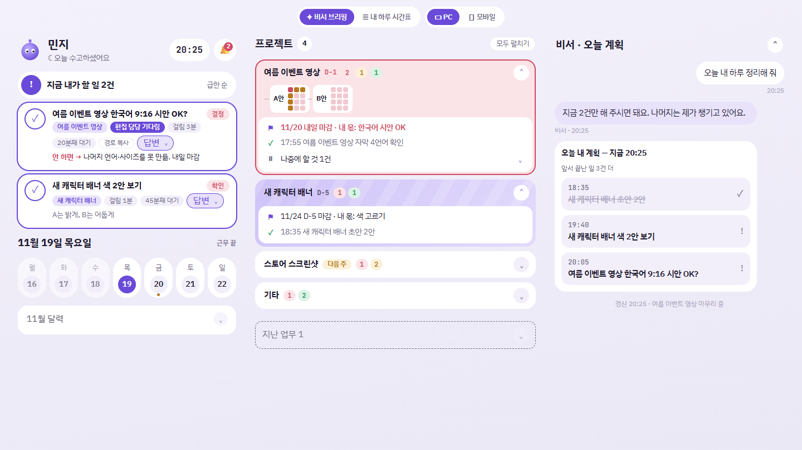
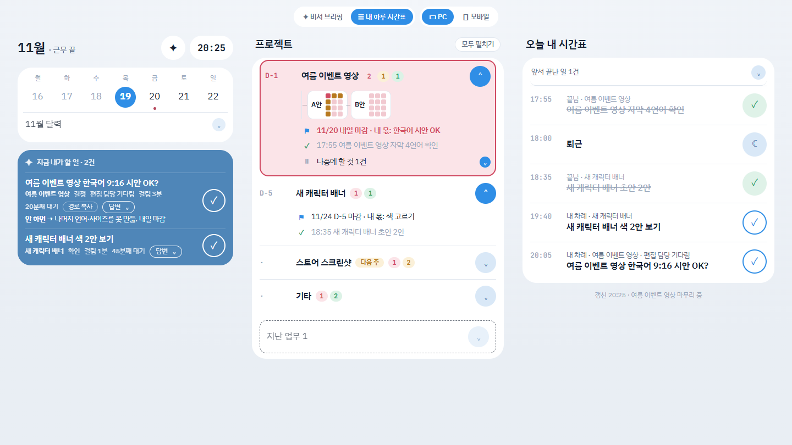
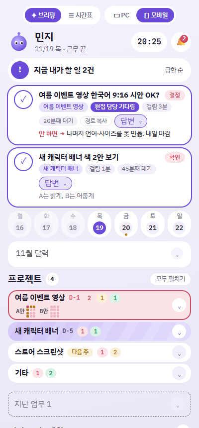

# 오늘 상황판

AI 에이전트(Claude, Codex·GPT 등)와 함께 일할 때, **"지금 내가 할 일이 뭐지?"**를 한 화면으로 보는 상황판입니다. 화면은 에이전트가 채우고, 사람은 보고 체크하거나 답만 하면 됩니다.

- 맨 위: 지금 내가 해 줘야 하는 것(확인·결정)
- 그 아래: 프로젝트별로 에이전트가 하는 일, 마감, 끝난 일, 나중에 할 일

화면은 하나이고, 설치하는 길이 둘입니다. 쓰는 에이전트에 맞는 쪽을 고르세요.

| | A. Claude를 쓰는 경우 | B. Codex·GPT 등을 쓰는 경우 |
|---|---|---|
| 화면이 뜨는 곳 | claude.ai의 Artifact(내 계정에서만 보임) | 내 PC의 브라우저(`http://127.0.0.1:8765`) |
| 자료가 있는 곳 | 그 Artifact 안 | 이 폴더의 `board-data.json` |
| 필요한 것 | Artifact를 게시할 수 있는 Claude | Windows: 없음(필요하면 스스로 받음) · macOS/Linux: 파이썬 3.8 이상 |

## 설치 A — Claude

1. 이 폴더를 내려받아 아무 곳에나 둡니다.
2. `agents/CLAUDE.md`의 내용을 프로젝트의 `CLAUDE.md`에 붙여 넣습니다.
3. Claude에게 이렇게 말합니다.
   > today-board 폴더의 board.html로 내 상황판을 만들어 줘. 내 이름은 ○○이야.
4. Claude가 화면을 게시하고 주소를 알려 줍니다. 그 주소를 즐겨찾기에 넣어 두세요.

그다음부터는 Claude가 일을 받을 때·끝낼 때·물어볼 것이 생길 때 상황판을 스스로 고칩니다. 화면에서 체크하거나 답을 고르면 Claude가 다음 차례에 읽습니다.

## 설치 B — Codex·GPT (파일 방식)

1. 이 폴더(`today-board`)를 내려받아 아무 곳에나 둡니다. 폴더째로 옮겨도 그대로 돕니다(안에 내 PC의 경로가 적혀 있지 않습니다).
2. **켜기**: Windows는 폴더 안의 `start.bat`을 두 번 누릅니다. macOS·Linux는 터미널에서 `sh start.sh`.
   - 처음이면 예시 자료로 상황판을 만들고, 브라우저가 저절로 열립니다.
   - **Windows에서는 따로 설치할 것이 없습니다.** PC에 파이썬이 없으면 `start.bat`이 전용 파이썬(약 11MB)을 이 폴더 안 `tools\python`에 스스로 내려받습니다. 설치 과정도, 관리자 권한도 없고, PC의 다른 곳은 건드리지 않습니다. 지우려면 그 폴더만 지우면 됩니다.
   - 검은 창(터미널)은 닫지 마세요. 닫으면 화면에서 체크·답을 할 수 없습니다.
3. `agents/AGENTS.md`의 내용을 내 프로젝트의 `AGENTS.md`에 붙여 넣고, 맨 위 '상황판 폴더' 한 줄에 이 폴더를 둔 곳을 적습니다.
4. 에이전트에게 이렇게 말합니다.
   > 상황판을 비우고 내 이름을 ○○으로 넣어 줘. 앞으로 일할 때마다 상황판을 고쳐 줘.

직접 명령으로 하려면 이 폴더 안에서(macOS·Linux는 `board.cmd` 대신 `python3 tools/board.py`):
```
board.cmd init --empty --force     # 예시를 지우고 빈 상황판으로
board.cmd set-meta me="내 이름" agent="비서"
board.cmd serve --open
```

- 화면에서 체크하거나 답하면 `inbox/` 폴더에 한 장씩 남고, 에이전트가 `board.py inbox`로 읽습니다.
- 이 서버는 **내 PC에서만** 열립니다. 다른 사람이나 다른 기기에서는 접속할 수 없습니다.
- 보기만 할 때는 켜지 않아도 됩니다. `board.html`을 그냥 열면 읽기 전용으로 보입니다.
- macOS·Linux는 파이썬 3.8 이상이 있어야 합니다(대부분 이미 있습니다). 없으면 `sh start.sh`가 알려 줍니다.
### 잘 안 될 때
| 증상 | 해결 |
|---|---|
| "Could not get Python automatically" | 인터넷이 막혀 전용 파이썬을 못 받은 것입니다. 창에 나온 한 줄(`winget install …`)을 터미널에 붙여 넣거나, python.org에서 설치한 뒤 다시 켜세요 |
| 주소의 숫자가 8765가 아님 | 8765번을 다른 프로그램이 쓰고 있어 다음 번호로 연 것입니다. 검은 창에 적힌 주소로 여세요 |
| "자료 파일이 없습니다" | `board.py init`을 먼저 |
| 값에 따옴표가 있어 명령이 깨짐 | JSON을 파일에 쓰고 `board.py card set <id> --file card.json` |
| 화면이 안 바뀜 | 화면은 3초마다 다시 읽습니다. `board.py list`로 자료가 바뀌었는지 먼저 확인 |

### 도구가 제대로 도는지 확인
```
python tools/test_board.py
```
마지막 줄이 `ALL PASS`면 됩니다. 임시 폴더에서 돌고 내 상황판은 건드리지 않습니다.

## 넣으면 안 되는 것
상황판 자료에는 비밀번호·토큰·주민번호 같은 것을 쓰지 마세요. A 방식의 자료는 그 Artifact를 열 수 있는 사람 모두에게 보이고, B 방식의 자료는 폴더에 글자 그대로 저장됩니다. 이 폴더를 저장소에 올릴 때는 `board-data.json`, `board-data.js`, `inbox/`를 빼세요(`.gitignore`에 들어 있습니다).

## 화면 보는 법



*그림은 모두 가짜 예시 자료(`board-data.sample.json`)입니다.*

### 맨 위 알약 두 개
- **모양**: ✦ 비서 브리핑 / ☰ 내 하루 시간표. 같은 자료를 두 가지 모양으로 봅니다.
- **화면**: ▭ PC / ▯ 모바일. PC는 세 칸이고, 창이 좁으면 두 칸으로 바뀝니다.
- 고른 것은 이 브라우저가 기억합니다.

### 지금 내가 할 일 (맨 위)
에이전트가 나를 기다리는 것만 급한 순으로 나옵니다.
- **✓** — "했어요". 누르면 이 칸에서 빠집니다.
- **답변 ⌄** — 펼치면 선택지 중 하나를 고르고, '기타'와 메모를 쓸 수 있습니다. 보내면 에이전트에게 알림이 갑니다.
  - Claude: 댓글 알림
  - 파일 방식: `inbox/`
- **안 하면 →** — 미루면 무엇이 막히는지.
- **경로 복사** — 볼 파일의 경로.

### 프로젝트
- 이름 옆 숫자는 글 대신 색입니다. 마우스를 올리면 풀이가 나옵니다.
  - 🔴 해야 함(지금 할 일 · 정할 것 · 나중에 할 것)
  - 🟡 하는 중(에이전트가 진행 중 · 다음 주 예정)
  - 🟢 끝(오늘 끝 · 답함)
- **D-5** 같은 숫자는 마감까지 남은 날입니다. **마감이 내일이거나 지났으면 상자 전체가 빨갛게** 됩니다.
- 이름 옆 **작은 격자**는 변형(언어 × 사이즈) 진행입니다.
  - 칸 하나가 영상 한 편이고, 초록은 끝, 노랑은 만드는 중, 빨강은 내 확인이나 시작 전입니다.
  - 펼치면 큰 격자가 나오고, 칸을 누르면 그 칸의 메모가 보입니다.
- 펼치면 정할 것(질문) → 마감과 내 몫 → 끝난 일 → 다음 주 할 것 → 나중에 할 것 → 에이전트 상태 순으로 나옵니다.
- **지난 업무**: 끝난 프로젝트는 맨 아래 점선 상자 안에 접혀 있습니다.
- 접고 펼친 상태는 이 브라우저가 기억합니다. '모두 펼치기/접기' 버튼도 있습니다.

### 달력
- 주 달력 아래에 **월 달력**이 접혀 있습니다.
- 점 색: 빨강 마감 · 초록 끝 · 노랑 예정.
- 날짜를 누르면 그날 일만 보이고, 다시 누르거나 '전체 보기'를 누르면 이번 달 전체가 보입니다.

### 오늘 계획 / 시간표
- 비서 브리핑의 오른쪽 칸은 에이전트가 정리해 준 오늘 계획입니다.
- 내 하루 시간표에서는 오늘 일이 시간순으로 놓이고 '지금' 선이 그어집니다.



### 위쪽 안내 줄
| 안내 | 뜻 |
|---|---|
| 아직 상황판 자료가 없어요 | 자료가 비어 있음. 예시를 넣거나 에이전트에게 채워 달라고 하세요 |
| 지금은 읽기 전용이에요 | `board.html`을 파일로 바로 연 상태. `board.py serve`를 켜고 그 주소로 열면 ✓·답을 할 수 있음 |
| 서버에 닿지 못했어요 | `serve`를 켜 둔 터미널이 닫혔음 |


